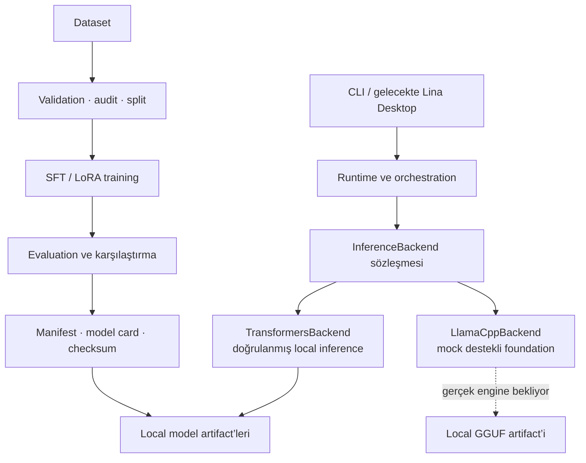

# LinaCore

**Lina ekosistemi için local-first, typed ve modüler yapay zekâ runtime’ı ve model geliştirme altyapısı.**

[](https://github.com/ilhanki/LinaCore/actions/workflows/ci.yml)
[](https://www.python.org/downloads/)
[](https://github.com/ilhanki/LinaCore)
[](LICENSE)

LinaCore; local modelleri keşfetmek, doğrulamak, çalıştırmak ve ölçmek için açık sözleşmeler
sunar. Aynı repository içinde dataset kalite kontrolü, deterministik split, SFT/LoRA training,
behavioral evaluation ve güvenli model artifact üretimi bulunur. Temel paket ağır ML
bağımlılıkları kurmaz; Transformers, Torch, PEFT ve llama.cpp yalnız ihtiyaç duyulan optional
extra gruplarıyla eklenir.

Proje **pre-alpha** aşamasındadır. Transformers ile gerçek local inference ve uçtan uca model
geliştirme pipeline’ı doğrulanmıştır. Deneysel Lina modelleri production-ready değildir;
gerçek GGUF export ve llama.cpp inference henüz doğrulanmamıştır.

> **LinaCore, Lina Desktop değildir.** LinaCore inference, model, dataset ve training
> sözleşmelerini sağlayan çekirdek Python katmanıdır. Lina Desktop gelecekte bu katmanı
> kullanabilecek ayrı bir masaüstü uygulamasıdır; bugün iki proje arasında entegrasyon yoktur.

## Mevcut durum

| Alan | Durum | Not |
| --- | --- | --- |
| Typed `InferenceBackend` sözleşmesi | Hazır | Provider bağımsız runtime sınırı |
| Transformers backend | Çalışıyor | Local model load, generation ve streaming doğrulandı |
| Gerçek local model inference | Doğrulandı | SmolLM2-135M ile compatibility akışı tamamlandı |
| Dataset ve SFT pipeline | Çalışıyor | Validation, fingerprint, split ve artifact üretimi |
| LoRA training | Çalışıyor | Assistant-only selective causal LM loss ile |
| Behavioral evaluation | Çalışıyor | Bağımsız holdout ve üç-model karşılaştırması |
| `Lina-0.5B-SFT-v0.2` | Deneysel · `PARTIAL` | 45/90; kalite ve güvenlik kapılarını geçmedi |
| GGUF export contract | Hazır | Güvenli, mock destekli foundation |
| Gerçek GGUF export / llama.cpp inference | Doğrulanmadı | Conversion ve engine entegrasyonu bekliyor |
| Lina Desktop entegrasyonu | Yok | Yakın dönem hedefi |
| Production-ready Lina modeli | Yok | Deneysel artifact’ler araştırma çıktısıdır |

## Öne çıkan özellikler

### Runtime ve backends

- Typed inference request/response, generation options ve hata modeli
- Generation, streaming, cancellation ve stop sequence desteği
- Token usage, latency, health ve resource reporting
- Device detection; dtype ve quantization policy foundation
- Transformers local inference ve mock destekli `LlamaCppBackend` foundation
- Optional dependency availability reporting

### Model yönetimi

- Strict TOML model manifesti, discovery, validation ve inspection
- Model/tokenizer provider sözleşmeleri ve prompt rendering
- Chat template policy ve context budgeting
- Revision, lisans, capability, checksum ve provenance alanları
- Güvenli GGUF export planı ve atomik model artifact üretimi

### Training ve evaluation

- Strict dataset validation, canonical SHA-256 fingerprint ve deterministik grouped split
- Full SFT ve PEFT LoRA training; assistant tokenlarına özel selective causal LM loss
- Validation, best-state seçimi, sınırlı checkpoint ve LoRA merge
- Base/fine-tuned model karşılaştırması ve bağımsız behavioral holdout
- Model card, manifest, metadata, checksum ve typed evaluation report üretimi

### Güvenlik ve geliştirici deneyimi

- Local-only varsayılanlar, model-root sınırı ve path traversal/symlink escape kontrolleri
- Typed configuration, diagnostics ve Türkçe CLI çıktıları
- İnternet veya model ağırlığı istemeyen hermetic varsayılan test suite’i
- Ruff, strict mypy, package build, dependency check ve public repository audit
- Ağır ML dependency’si içermeyen hafif core kurulum

## Mimari



Backend ayrıntıları contract katmanının dışındadır. Model discovery ağırlıkları yüklemeden
çalışır; gerçek inference ancak doğrulanmış local manifest ve ilgili optional dependency’lerle
başlar. Training hattı da yalnız açık kullanıcı onayıyla model yükler ve artifact üretir.

## Hızlı başlangıç

Python 3.11 veya üzeri gerekir.

### Windows PowerShell

```powershell
python -m venv .venv
.\.venv\Scripts\Activate.ps1
python -m pip install --upgrade pip
python -m pip install -e ".[dev]"
```

### Linux / macOS

```bash
python -m venv .venv
source .venv/bin/activate
python -m pip install --upgrade pip
python -m pip install -e ".[dev]"
```

`.[dev]` yalnız geliştirme ve kalite araçlarını kurar; Torch, Transformers, NumPy, PEFT veya
llama.cpp kurmaz. Kullanım alanına göre yalnız gerekli grubu ekleyin:

```powershell
# Transformers local inference
python -m pip install -e ".[inference-transformers,inference-torch]"

# Full SFT training
python -m pip install -e ".[training]"

# LoRA dahil training
python -m pip install -e ".[training-all]"

# llama.cpp foundation geliştirmesi
python -m pip install -e ".[inference-llama-cpp]"
```

`inference-llama-cpp` kurulumu tek başına gerçek GGUF inference’ın bu sürümde doğrulandığı
anlamına gelmez.

## CLI kullanımı

Kurulumdan sonra `lina-core` entry point’i veya eşdeğer `python -m lina_core` biçimi
kullanılabilir.

```powershell
python -m lina_core version
python -m lina_core health
python -m lina_core diagnostics --json
python -m lina_core backends list
python -m lina_core devices list
python -m lina_core models discover
python -m lina_core runtime smoke
```

Bir local model manifestini doğrulamak ve keşfedilmiş modeli incelemek için:

```powershell
python -m lina_core models validate models/my-model/linacore-model.toml
python -m lina_core models inspect my-model
```

### Local inference

`Lina-0.5B-SFT-v0.2` artifact’i local olarak mevcutsa:

```powershell
python -m lina_core inference generate `
  --model lina-0.5b-sft-v0.2 `
  --prompt "Merhaba, sen kimsin?" `
  --max-new-tokens 96 `
  --temperature 0 `
  --seed 42
```

Streaming için `generate` yerine `stream` kullanılır. Prompt komut geçmişinde kalabileceği
için CLI’a hassas veri vermeyin.

Model ağırlıkları repository’de bulunmaz. Bu komut ancak model önce local olarak eğitildiyse
veya kullanıcı `models/` altında geçerli bir LinaCore artifact’i sağladıysa çalışır. LinaCore
varsayılan olarak model indirmez.

## Lina Model v0.2 akışı

v0.2 config’i base modeli `models/qwen2.5-0.5b-instruct` altında bekler;
`local_files_only=true`, `allow_download=false` ve `trust_remote_code=false` uygular.
Gerçek training manual/local bir işlemdir ve CI’da çalışmaz.

```powershell
# 1. Dataset’i doğrula
python -m lina_core dataset validate data/examples/lina_sft_v0.2.jsonl

# 2. Training planını model yüklemeden incele
python -m lina_core train plan `
  --config configs/training/lina-0.5b-sft-v0.2.toml `
  --profile quality

# 3. Local base model hazırsa training’i açıkça onayla
python -m lina_core train run `
  --config configs/training/lina-0.5b-sft-v0.2.toml `
  --profile quality `
  --yes

# 4. Base, v0.1 ve v0.2 modellerini aynı holdout üzerinde karşılaştır
python scripts/compare_lina_models_v0_2.py `
  --v0-2-manifest models/lina-0.5b-sft-v0.2/linacore-model.toml

# 5. Üretilen artifact’i incele
python -m lina_core models inspect lina-0.5b-sft-v0.2
```

Genel evaluation runner’ı model gerektirmeyen örnek config ile ayrıca doğrulanabilir:

```powershell
python -m lina_core evaluation run configs/evaluation.example.toml
```

Karşılaştırma raporları `reports/` altında üretilir ve Git tarafından izlenmez.

## Deneysel modeller

| Model | Base model | Dataset | Yöntem | Behavioral holdout | Durum |
| --- | --- | ---: | --- | ---: | --- |
| `Lina-135M-SFT-v0.1` | `HuggingFaceTB/SmolLM2-135M` | 24 kayıt | Full SFT | 2/90 | Pipeline MVP |
| `Lina-0.5B-SFT-v0.2` | `Qwen/Qwen2.5-0.5B-Instruct` | 600 kayıt | LoRA SFT | 45/90 (%50) | `PARTIAL` |

Bu modeller **sıfırdan pretrained değildir**. Açık base modeller üzerine supervised
fine-tuning uygulanmış deneysel artifact’lerdir; model ağırlıkları bu kaynak kod
repository’sinde yayımlanmaz.

### Lina v0.2 değerlendirme özeti

| Ölçüm | Sonuç |
| --- | ---: |
| Sentetik dataset | 600 kayıt · 30 kategori |
| Split | 480 train · 60 validation · 60 test |
| Bağımsız behavioral holdout | 90 prompt |
| Qwen2.5-0.5B-Instruct base | 4/90 |
| Lina v0.1 | 2/90 |
| Lina v0.2 | 45/90 (%50) |
| Lina v0.2 kritik failure | 12 |
| Sprint kararı | `PARTIAL` |

v0.2 baseline modellerden belirgin biçimde daha iyi sonuç verdi; ancak minimum %60 kabul
eşiğini ve sıfır kritik failure koşulunu karşılamadı. Canlı inference kontrollerinde bozuk
Türkçe, şablon karışması, yabancı karakterler ve anlamsız cümle birleşimleri görüldü. Bu
nedenle model çalışan bir araştırma artifact’i ve pipeline doğrulamasıdır; güvenilir günlük
asistan veya production modeli olarak sunulmaz. Ayrıntılar ve training ölçümleri için
[Lina Model v0.2 sonuç belgesine](docs/lina-model-v0.2.md) bakın.

## Test ve kalite

`main` dalındaki CI aynı 374 benzersiz testi iki desteklenen Python sürümünde çalıştırır:

| Kontrol | Python 3.11 | Python 3.12 |
| --- | ---: | ---: |
| Pytest | 374 passed, 1 deselected | 374 passed, 1 deselected |
| Ruff | Başarılı | Başarılı |
| Strict mypy | Başarılı | Başarılı |
| Compileall | Başarılı | Başarılı |
| Package build | Başarılı | Başarılı |
| Pip check | Başarılı | Başarılı |
| Public audit | Başarılı | Başarılı |

İki ortamın toplamında 748 başarılı test çalıştırması vardır; bu sayı 748 farklı test olduğu
anlamına gelmez. Benzersiz test sayısı 374’tür. `manual_integration` ve `model_integration`
marker’ları gerçek local model, optional ML dependency veya açık kullanıcı onayı gerektirir;
varsayılan CI akışına dahil değildir.

```powershell
python -m ruff check .
python -m mypy src/lina_core
python -m pytest -m "not manual_integration and not model_integration"
python -m compileall -q src
python -m build
python -m pip check
python scripts/audit_public_repository.py
```

## Güvenlik sınırları

- Model ağırlıkları, `.gguf`, `.safetensors`, checkpoint, cache ve generated report dosyaları
  Git’e eklenmez.
- Transformers varsayılanları `local_files_only=true`, `trust_remote_code=false` ve remote
  download kapalı olacak biçimde tasarlanmıştır.
- Model ve export yolları configured local model root sınırları içinde kalmalıdır.
- Manifest, config, dataset, prompt ve provider çıktıları güvenilmeyen girdi kabul edilir.
- Dataset validator secret, token ve kişisel yol benzeri içeriği reddeder.
- CI public repository audit çalıştırır; buna rağmen raw secret, credential veya kişisel dosya
  yolu hiçbir zaman commit edilmemelidir.

Model dosyaları ve native ML dependency’leri ayrıca incelenmelidir. Ayrıntılı güven sınırları
için [Security belgesini](docs/security.md), güvenlik açığı bildirmek için
[SECURITY.md](SECURITY.md) dosyasını okuyun.

## Proje yapısı

```text
LinaCore/
├── src/lina_core/   # Runtime, backends, models, datasets, training ve evaluation
├── configs/         # Inference, evaluation ve training örnekleri
├── data/examples/   # Sürüm kontrollü sentetik dataset ve holdout örnekleri
├── docs/            # Mimari ve kullanım belgeleri
├── examples/        # Güvenli model manifesti örnekleri
├── scripts/         # Audit, dataset üretimi ve manual model akışları
└── tests/           # Unit ve hafif integration testleri
```

`models/`, `checkpoints/` ve `reports/` yalnız README placeholder’larını izler; üretilen
artifact’ler ignore edilir.

## Dokümantasyon

| Konu | Belge |
| --- | --- |
| Mimari ve runtime | [Mimari](docs/architecture.md) · [Runtime](docs/runtime.md) |
| Backends ve inference | [Backends](docs/backends.md) · [Inference](docs/inference.md) |
| Model yönetimi | [Modeller](docs/models.md) · [Compatibility](docs/model-compatibility.md) |
| Dataset | [Dataset](docs/datasets.md) |
| Training | [Training](docs/training.md) · [İlk Lina modeli](docs/first-lina-model.md) |
| Evaluation | [Evaluation](docs/evaluation.md) · [Lina Model v0.2](docs/lina-model-v0.2.md) |
| GGUF | [GGUF export](docs/gguf-export.md) |
| Donanım ve config | [Hardware](docs/hardware.md) · [Configuration](docs/configuration.md) |
| Güvenlik | [Security](docs/security.md) · [Security policy](SECURITY.md) |
| Geliştirme | [Development](docs/development.md) · [Contributing](CONTRIBUTING.md) |
| Yol haritası | [Genel roadmap](docs/roadmap.md) · [Model roadmap](docs/model-roadmap.md) |

## Yol haritası

- Chat-template kaynaklı bozulmaları teşhis etmek
- LoRA merge sonucunu tokenizer ve generation düzeyinde doğrulamak
- Dataset yanıt şablonu çeşitliliğini artırmak
- Behavioral evaluation ve insan-review kalibrasyonunu sertleştirmek
- Kritik failure sayısını sıfıra indirmek
- Gerçek GGUF export ve quantization akışını doğrulamak
- Gerçek llama.cpp inference adapter’ını tamamlamak
- Lina Desktop ile local entegrasyon sınırını kurmak

Tarih veya teslim garantisi verilmez; tamamlanmamış maddeler mevcut özellik olarak sunulmaz.

## Katkı

Geliştirme ortamı, kod/dil standardı ve doğrulama zinciri için
[CONTRIBUTING.md](CONTRIBUTING.md) dosyasını okuyun. Hata raporlarında model ağırlığı, private
dataset, credential veya kişisel veri paylaşmayın.

## Lisans

LinaCore kaynak kodu [MIT License](LICENSE) ile sunulur. Base model, tokenizer, dataset ve
üretilen model artifact’lerinin lisansları bağımsızdır; LinaCore ile kullanılmaları onları MIT
kapsamına sokmaz. Örneğin Lina v0.2’nin base modeli Qwen2.5-0.5B-Instruct Apache-2.0
lisanslıdır. Her modelin lisansını ve kullanım koşullarını ayrıca doğrulayın.

---

LinaCore, local AI sistemlerinin yalnızca çalışmasını değil; sınırlarının typed, test edilebilir
ve denetlenebilir olmasını hedefleyen bir açık kaynak mühendislik çalışmasıdır.
